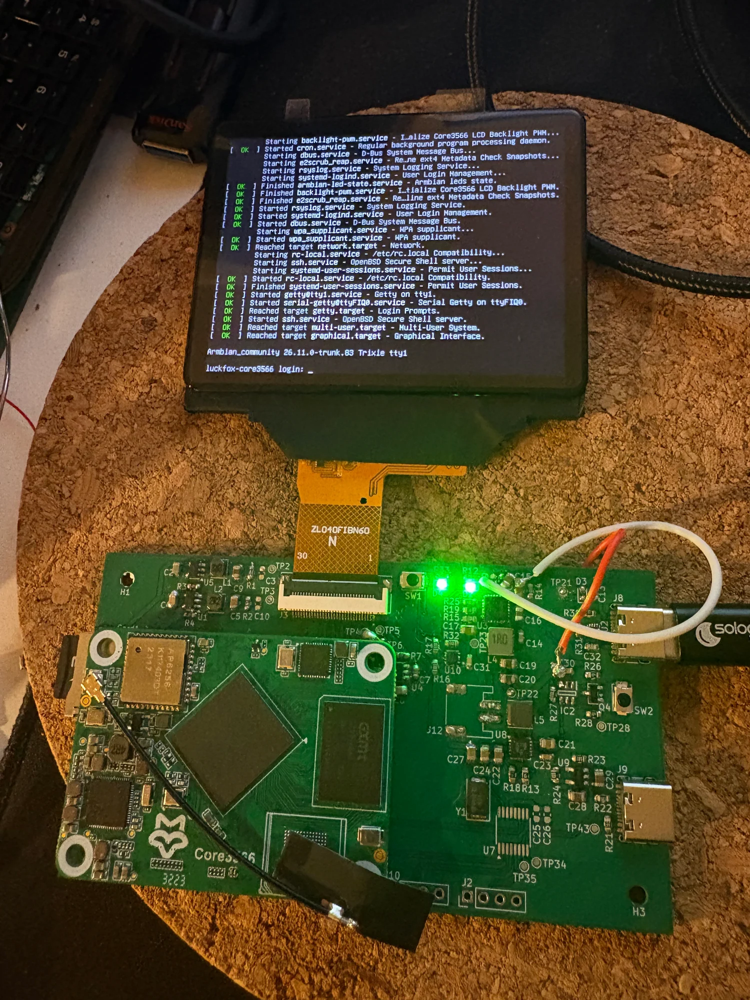

# Core3566 Mini Linux Carrier Board

**A compact RK3566 embedded Linux carrier board with a 4-inch MIPI DSI display.**

## Project overview

This project explores a compact Linux device built around the **Luckfox Core3566** module. The current prototype demonstrates a connected display showing a Linux desktop/terminal environment. Future directions include a keyboard-equipped mini Linux PC, a portable debug terminal, or other embedded applications.

### Current prototype

| Component | Current prototype status |
| --- | --- |
| Compute module | Luckfox Core3566 (Rockchip RK3566) |
| Display | 4-inch MIPI DSI display from the low-cost portable console R36s, labelled `ZL040FIBN60`, NV3051D controller |
| Display timing | 640 × 480; exact timing/init data included in the developer package, links can be found below |
| Backlight | PWM-controlled; boot-time configuration tested on the prototype |
| OS | Armbian / Debian 13 (Trixie) used during development |
| PCB | Custom carrier board prototype; editable design and manufacturing files can be found in the link below |
| Battery / additional peripherals | Experimental or planned; not promised as supported features |

  
  

## Why this project?

I've come across several interesting portable Linux projects, but many of them rely on bulky HDMI displays, often requiring additional HDMI interface circuitry and increasing both cost and device thickness.

On the other hand, many affordable handheld gaming consoles available on AliExpress use low-cost MIPI DSI displays, which allow for simpler PCB routing and more compact designs.

This led me to an idea: **why not build an expandable carrier board that combines a compute module with an affordable MIPI DSI display?**

The result is this **Developer Package**, which brings together the hardware design, display integration and software configuration needed to reproduce the prototype.

Bringing up a compact MIPI display on Linux requires more than PCB fabrication: display initialization, MIPI DSI timing, GPIO reset, kernel/device-tree configuration, backlight management and a reproducible OS environment all need to agree. The goal of the **Developer Package** is to collect the original hardware design and the tested integration instructions in one place.

## Documentation

- [Software and display integration overview](docs/software.md)

## Complete Developer Package

The package includes:

- Editable KiCad schematic and PCB project, Gerber outputs and BOM.
- An identified, tested display-module configuration and its initialization/timing parameters.
- Device tree **source** (`.dtso` or `.dts`) and matching compiled overlay (`.dtbo`) or DTB as appropriate.
- Backlight configuration and reproducible installation instructions.
- Exact tested Armbian image and kernel version, installation guide, and troubleshooting notes.

[Purchase **Developer Package** on Payhip](https://payhip.com/b/or7T2)

## Important compatibility notes

- Tested with a specific display, low-cost (which aligns with the goal of bringing this project to you) which is widely used on the R36S portable console. Other display modules are **not guaranteed** to work.
- A compiled DTBO may depend on the bootloader, kernel, base DTB and the exact Armbian image. Use only the documented combination.
- Any third-party software, firmware and device-tree source material retains its applicable licenses. The license status of each deliverable will be documented prior to release.

## Contact and feedback

Please use the repository's **Issues** tab for project questions. For purchase-related support, a contact route will be listed with the product when released.

## Licensing and ownership

No license is granted here for unpublished KiCad design files or a future paid package. The text and original assets in this preview are reserved unless explicitly licensed. Any third-party assets must be credited and distributed according to their own licenses.
